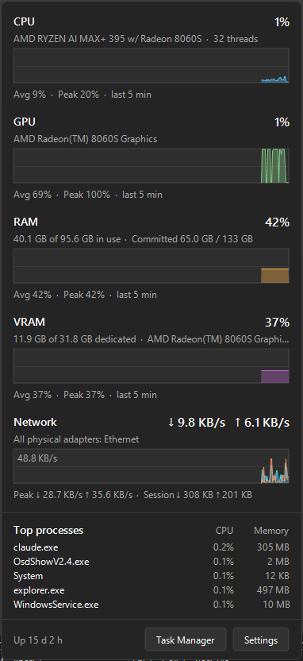
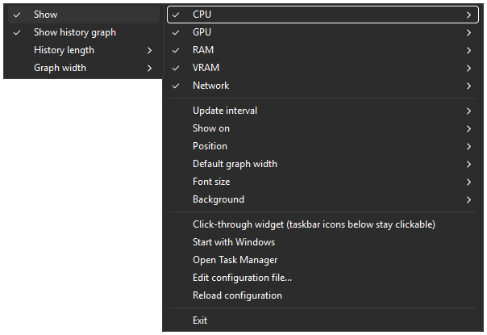

# Taskbar System Info

**Version 1.0** · Windows 10 / 11 · portable x64 · single ~300 KB exe, no installer, no runtime

A tiny native app that shows live system information directly in the Windows taskbar, the same way the Weather widget does:
CPU, GPU, RAM, VRAM and network bandwidth, each with its current value and a history graph.


Click the widget for a details panel; right-click it (or the tray icon) for settings.

<p>
  
  &nbsp;&nbsp;
  
</p>

## Download

Get **`TaskbarSysInfo-1.0-win-x64-portable.zip`** from the [Releases](https://github.com/darko1979/taskbar-system-info/releases/latest) page.
Unzip it anywhere (USB stick, `Documents`, …) and run `TaskbarSysInfo.exe`.
Settings are stored in `TaskbarSysInfo.ini` next to the exe. To remove the app, exit it and delete the folder.
If you used *Start with Windows*, turn that off first.

## Features

| Item    | Taskbar text                  | History graph |
|---------|-------------------------------|---------------|
| CPU     | total usage %                 | usage % |
| GPU     | usage % (busiest engine, like Task Manager) | usage % |
| RAM     | usage % and used GB           | usage % |
| VRAM    | usage % and used dedicated GB | usage % |
| Network | upload / download rate        | download (filled) + upload (line), auto-scaled |

Each item can be configured on its own:
* **Show or hide** the item.
* **History graph**: on or off.
* **History length**: 30 s to 1 h.
* **Graph width**: 24 to 100 px, or the default width.
* **GPU / VRAM**: pick the graphics adapter, or *Automatic* (the one with the most dedicated memory).
* **Network**: measure all physical adapters or one interface, in bytes/s or bits/s.

General options:
* **Show on**: main taskbar, second taskbar, or all taskbars (multi-monitor).
* **Position**: next to the notification area or on the left side.
  On Windows 11 it automatically keeps clear of the Weather/Widgets button.
* **Other display settings**: update interval (0.5 to 5 s), font size, background.
* **Click-through widget**: the widget ignores the mouse, so taskbar icons underneath it stay clickable.
* **Start with Windows**: the path is kept current if you move the folder.
* **Light/dark**: text color follows the taskbar theme. Scaling is per-monitor DPI aware.

### Mouse

| Where       | Action      | Result |
|-------------|-------------|--------|
| Widget      | hover       | Windows 11-style highlight |
| Widget      | left click  | details flyout (see below) |
| Widget      | right click | settings menu |
| Tray icon   | left click  | details flyout |
| Tray icon   | right click | settings menu |
| Tray icon   | hover       | text summary |

The **details flyout** shows:
* larger graphs for each item, with average and peak over the history window
* CPU model and thread count, GPU name
* RAM in use and committed, dedicated VRAM
* active network adapters, with peak rates and session totals
* the top 5 processes by CPU, with their private memory
* system uptime, plus **Task Manager** and **Settings** buttons

It closes on click-away or Esc. With *Click-through widget* enabled, use the tray icon instead.

## Configuration file

Everything in the menu is saved to `TaskbarSysInfo.ini`. A few extra options are only in the file:
`Offset` (shift from the anchor), `Spacing`, `FontName`, `TextColor`, `BackgroundColor` and per-item `Color` values.
After editing, choose **Reload configuration** from the menu.

```ini
[General]
Taskbars=0          ; 0 = main, 1 = second taskbar(s), 2 = all
Position=0          ; 0 = next to notification area, 1 = left side
ClickThrough=0
GraphWidth=40       ; default graph width (px at 100 % scale)
[CPU]
Show=1
Graph=1
History=300         ; seconds
GraphWidth=0        ; 0 = use the default
Color=4FC3F7
[Network]
Interface=          ; empty = all physical adapters, otherwise the adapter name, e.g. Ethernet
Bits=0
ColorDown=4DD0E1
ColorUp=FF8A65
```

## Resource use

Measured on Windows 11 at a 1 s update interval: about **9 MB** private memory and **under 1 % of one CPU core**.
The process runs in EcoQoS (efficiency) mode.

## How it works

* **Language**: C++17 with the plain Win32 API, built with MSVC and a static CRT. The result is one native exe with
  no dependencies, which starts instantly and uses as little memory as possible.
* **Sampling** runs on a worker thread, so the taskbar's UI thread is never blocked:
  * CPU via `GetSystemTimes`
  * RAM via `GlobalMemoryStatusEx`
  * GPU and VRAM via the PDH `GPU Engine` / `GPU Adapter Memory` counters, the same source as Task Manager, with totals from DXGI.
    These counters are only queried while GPU or VRAM is shown.
  * Network via `GetIfTable2` 64-bit counters
* **Widget**: a per-pixel-alpha layered child window of `Shell_TrayWnd` / `Shell_SecondaryTrayWnd`, rendered with GDI+.
  If embedding fails it falls back to a topmost overlay window. It re-attaches automatically when Explorer restarts.
* **Windows 11 placement**: the Windows 11 taskbar is drawn with XAML. A cached UI Automation query (every 2 s) locates the
  Widgets button and the tray/clock on each taskbar to find free space.
* **Windows 10**: on the classic taskbar the task-button band is shrunk to make room, and restored on exit.
* **Details flyout**: the top-process list comes from `NtQuerySystemInformation`. It is only sampled while the flyout is open.

## Building from source

Requires Visual Studio 2019 or newer with *Desktop development with C++* (MSVC and the Windows 10/11 SDK).

```bat
build.bat
```

The output is `bin\TaskbarSysInfo.exe`. `tools\make-icon.ps1` regenerates `res\app.ico`.

```
src/app.h        shared types: config, history ring buffer, samples
src/main.cpp     entry point, tray icon, menu, sampling thread, autostart
src/metrics.cpp  CPU / RAM / GPU / VRAM / network collection
src/widget.cpp   taskbar widget windows: embedding, layout, rendering, placement
src/flyout.cpp   details flyout and top-process sampling
src/probe.cpp    UI Automation probe for the Windows 11 taskbar
src/config.cpp   INI load/save, formatting helpers
```

## Limitations

* **Crowded Windows 11 taskbar**: Windows 11 doesn't let apps reserve taskbar space. With many pinned apps the widget can
  overlap task buttons. Use a narrower graph width, hide items, change `Offset` or enable *Click-through widget*.
* **VRAM** is *dedicated* video memory. Integrated GPUs mostly use shared memory, so their values are small.
* **GPU %** requires a WDDM 2.x driver (Windows 10 1709 or newer).
* **Windows 10 second-monitor taskbars** are supported in code but have not been tested yet.

## Changelog

### 1.0 (2026-11-13)
First release:
* CPU, GPU, RAM, VRAM and network with history graphs
* per-item show, graph, history length and graph width
* multi-taskbar support
* details flyout
* click-through mode
* portable INI configuration
